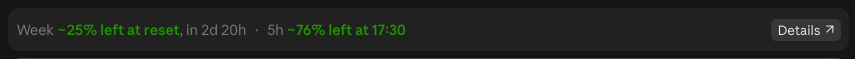

# Token Range Monitor

Like an electric car's range display, for your Claude limits: will your current pace carry you to the next reset?

- Watches the **weekly** and **5-hour** limits of a Claude Pro or Max subscription.
- Projects what will be left of each when it resets, at the pace you've been going.


## Install

### Claude Code CLI

Inside `claude` in a terminal, run:

```
/plugin install token-range-monitor --marketplace micke-dahlgren/token-range-monitor
```

- Answer `y`, then pick the **user** scope so it runs in every session.
- It's active right away.

### Claude desktop app (Code tab)

`/plugin install` isn't available in the app. Run these in any terminal instead:

```bash
claude plugin marketplace add micke-dahlgren/token-range-monitor
```

```bash
claude plugin install token-range-monitor@token-range-monitor
```

- Then run `/reload-plugins` in your Code tab session, or start a new one.
- This installs for your user, so it also runs in the CLI.

### Update

```bash
claude plugin update token-range-monitor
```

Then `/reload-plugins`, or start a new session.

## What it shows

### Above the prompt



- **Week:** what's projected to be left at the reset, in green: **~6% left at reset**. A forecast, not what's left now.
  - Won't make it? In orange, when you'd run out: **runs out Wed ~12:45**, 22h early.
  - **±N** shows when the projection has typically missed by more than 5 points.
  - **early** shows until a whole day is on record.
- **5h:** **cut off ~00:09** in orange, or **~55% left at 15:40** in green.
- Narrow terminal: shortens to `Week ~6% @reset 4d 13h · 5h out 00:09`.
- **Details** opens the pane.

### The pane

Open it with `/token-range`, or **Details** above the prompt.

- **This week:** what's left at the reset, the week as one bar, and your usage day by day against a daily budget.
- **Today:** whether you'll stay within today's budget at this pace.
- **5-hour window:** when you'd be cut off, or that you'll last to the reset.
- **Models:** your usage split by model and effort level, with each model's token cost.

## How the estimate works

- Each response reports every limit's % and reset time; the mod records them.
- **Pace** = the average of your last 7 whole days.
- **Left at reset** = 100% − (used now + the rest of today + your pace for each day left).
- **Your weekly rhythm:** after 14 days the mod looks at the usual use on that weekday to make better predictions.
- **Daily budget** = what was left at the start of today ÷ the days left.
- **Just installed:** until a whole day is on record, a simpler hourly estimate is used, tagged **early**.
- **5-hour cut-off** = now + what's left ÷ your rate since the window opened.

### Model costs
- Each response reports its model, effort and tokens.
- Every limit rise is shared among the responses behind it, weighed by token cost.
- Each model starts at its published list price and learns from your use over the last 14 days.

## Sync across devices

Off until you sign in. Without it, each computer only sees its own usage; the rest shows up as "used while away".

**Sign in**
1. At the bottom of the pane, press **Click here to enable sync between devices**.
2. Open the link shown and type the code from the pane (e.g. `ABCD-EFGH`).
3. Choose **Continue with Google** or **Continue with GitHub**.
4. Repeat on each device with the same account.

Only type a code your own Claude Code showed you, never one someone sent you.

**What's sent**
- Limit percentages and reset times.
- When your sessions were active.
- Per response: time, model, effort and token counts.
- This computer's name, to list your devices.
- **Never** prompts, replies, code, file names or project names.
- Account and organization ids are stored only as a keyed hash.

**Where and how long**
- A small Cloudflare server: [privacy policy](https://token-range-monitor.micke-dahlgren.workers.dev/privacy).
- Each day's data is deleted 15 days after its last update.
- A device unused for 90 days is signed out and removed.

**Manage it** in **⚙ Settings**:
- See your linked devices; **Remove** one you don't recognize.
- **Sign out** unlinks this device.
- **Delete synced data** removes everything on the server.
- `CLAUDE_CODE_DISABLE_NONESSENTIAL_TRAFFIC` turns sync off.

**Host your own:** see [`server/`](server/), then set the plugin's **Sync server** option.

## Good to know
- **Pro and Max only.** API-key usage has no subscription limits.
- **History starts at install,** recorded while a Claude Code session is open.
- **Usage elsewhere** (claude.ai, other devices) shows as a jump, unless you sync.
- **Kept:** the last 15 days, and daily totals for 8 weeks.
- **One history per Claude account.**
- **Local only** unless you sync.
- **Early-access mod API:** a Claude Code update may break it until the mod is updated.

## Development

Run it from this folder without installing:

```bash
claude --plugin-dir .
```

Check and test it:

```bash
claude plugin validate .
```

```bash
claude plugin test .
```

## License

MIT
