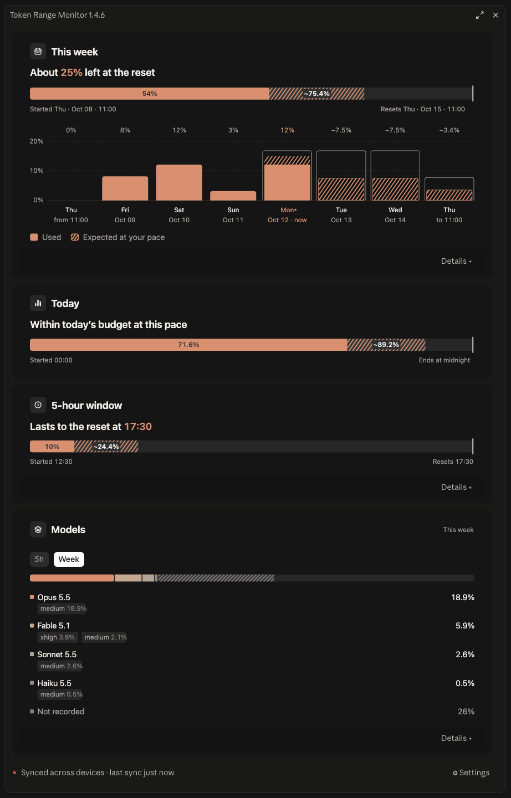

# Token Range Monitor

A Claude Code mod that tells you, like an electric car's range display, whether your current pace will carry you to the next limit reset.

It watches the weekly and 5-hour usage limits of your Claude Pro or Max subscription. It projects what will be left of each one when it resets, if you keep using Claude at the rate you have been.

<!-- Screenshot: add docs/pane.png and uncomment

-->

## Install

In a terminal, start `claude` and run:

```
/plugin install token-range-monitor --marketplace micke-dahlgren/token-range-monitor
```

Answer `y` to add the marketplace, then choose the **user** scope so it runs in every session. It also runs in sessions in the Claude desktop app's Code tab. The install line itself only works in a terminal.

To update later:

```bash
claude plugin update token-range-monitor
```

## What it shows

**Above the prompt**, one line:

> Week **6% to spare**, resets in 4d 13h · 5h **cut off ~00:09**, resets 00:40 · Details

- **Week:** what's projected to be left at the weekly reset, in green: **6% to spare**. If you won't make it, it says in red when you'd run out and how long before the reset: **runs out Wed ~12:45**, 22h early.
- **±N** follows the figure when the projection has typically missed by more than 5 points: `Week 9% to spare ±12`.
- **early** follows it until a whole day is on record (just after you install). Until then it's the older hourly estimate.
- **5h:** in clock times. **cut off ~00:09** in red if you'd hit the 5-hour limit before it resets, or **55% to spare** in green, then when it resets.
- In a narrow terminal it shortens to stay on one line: `Week +6% 4d 13h · 5h out 00:09 · Details`.
- **Details** opens the pane.

**The pane** has a card per limit, a projects card and a models card. Every % on them says what its 100% is, and a figure never mixes the week with the day.

**This week** (100% = your weekly limit):

- The head: "About 6% left at the reset", or "Runs out Wed ~12:45, 22h before the reset", and what that's based on: "At your pace over the last 7 whole days: 13.5% a day".
- The whole week as one bar: what's used, solid, and what your pace adds before the reset, striped.
- The days of this window side by side, each in % of your weekly limit: past days and today solid, later days striped at your pace. Today and the days after it are outlined at the **daily budget**, the most you can use each day and still reach the reset. Today turns red once it passes the budget.

**Today** (100% = today's budget), on the same card:

- **Predicted use today: 92.5% of daily budget**, red over 100%.
- A bar of today's use against its budget, and when the day ends.
- One sentence gives today's budget in week terms: what's left of the week divided by the days left, "14.6% of your weekly limit".

Under the card, a dim line says what 1.3 would have shown, so the change can be compared. The card's **Details** opens the older view: the chart of your usage, the choice of what its average covers (**Since reset**, or a custom 1–24 hours or 1–7 days), and **Last window**, how the previous window ended.

**Projects** splits this week's use by the project you worked in, in % of your weekly limit, largest first, plus **Other** and **Unused**, so the column adds up to 100%. It answers "did my side project eat my week?" at a glance. **What Other counts** lists Other's parts:

- **Desktop chats:** conversations in the desktop app's chat, which run in a temporary folder rather than a project.
- **Other devices:** responses synced from your other computers. Their project names stay there.
- **Before 1.4:** responses recorded before projects were tracked.
- **Away:** usage with no responses seen: claude.ai in a browser, the phone app, or a device without the plugin.

A project is the folder a session runs in, by its name. A git worktree under `<repo>/.claude/worktrees/` counts as its repository. Project names stay on this computer: sync never sends them.

**5-hour window** (100% = your 5-hour limit): "Cut off ~17:36 at this pace", or "Lasts to the reset at 15:40", and a line from the window's opening to its reset, with now and the cut-off marked.

**Models** shows what each model costs and where your week went:

- **Cost** compares each model token for token with a baseline you pick under **Compare with** (Sonnet by default). "Opus 4.7×" means the same tokens on Opus use 4.7 times as much of your limit as on Sonnet, whether it's a quick answer or a long agentic run. The likely range is shown beneath.
- **This week** splits the % of your weekly limit by model and effort level. Higher effort means more thinking tokens, so it shows here, not in the cost. Usage the plugin didn't see stays apart as **Not recorded**.

In the terminal, where there are no drawings, each card shows the same figures as text.

Open the pane with `/token-range`. You can also set the Details chart's window from the prompt: `/token-range 2d`, `/token-range 12h` or `/token-range reset`.

## How the estimate works

Each limit's percentage and reset time arrive with Claude's responses, and the mod records them.

**Days.** A day is 24 hours from the weekly reset's time of day, so days line up with the week. A day's use is how far the weekly figure rose in it, usage from elsewhere included.

**The weekly projection:**

- **Pace** = the average of your last 7 whole days, across weekly resets. Seven days always include a weekend, so it counts at its real weight.
- **Today** counts as at least one day at your pace, or more once you've used more.
- **Left at reset** = 100% − (used now + the rest of today + your pace for each whole day left).
- If that's below zero, you run out on the day the running total passes 100%.

So the figure only moves when you use Claude beyond today's expected use, or when a day ends. Idle hours, a night's sleep or a quiet evening don't swing it. A low day joins the 7-day pace once it ends.

**Your weekly rhythm.** Once 14 days are on record, each day left counts at what you usually use on that weekday: the median of that weekday's days. A weekday you're never active on counts as 0, so a weekend you never work adds nothing. A day is active when it uses at least a quarter of your median day with any use, which scales the same on Pro and Max.

**Daily budget** = what was left at the start of today ÷ the days left in the window, today included. It changes only when a day ends.

**Self-check.** At each day boundary the mod notes what it projected. When the window resets it compares those with what was actually left. When the typical miss over the last 4 windows is more than 5 points, the figure shows `±` that miss.

**Just after you install,** until a whole day is on record, the weekly figure is the older estimate (used so far ÷ hours since the reset, kept up to the reset), tagged **early**. It needs 6 hours after the reset; before that it shows **No data**.

**The 5-hour cut-off** = now + what's left ÷ your rate since the window opened, shown as a clock time. If that's past the reset, it lasts.

**The Details chart** keeps the older averages: **Since reset** (the default) needs no history, and a custom window needs that much recorded history. Weekly averages need at least 6 hours of data, because the weekly percentage moves in steps of about a point.

### Model costs

Every response, subagents' included, reports its model, effort and tokens. Between two readings of the 5-hour limit that this computer watched throughout, the mod knows how far the limit rose and which models did the work. Over the last 14 days it solves for each model's weight. It reads the 5-hour limit because it moves several times faster than the weekly one, which gives many more readings to learn from. Models compare the same on either limit, and this week's points are the 5-hour points exchanged at your account's own rate: how many 5-hour points went with each weekly point while this computer was watching. Within a model, output, input and cache tokens are combined at that model's published price ratios, so only the weight across models is learned.

Each model is judged on its own. Its cost shows once the 90% range of its weight is within ±20%. Until then its row shows **Learning** with a meter, and its points this week wait under **Not split yet**. With steady use, Opus usually shows within hours. A cheap model you rarely use, like Haiku in subagents, takes longer.

## Sync across devices

If you use Claude Code on more than one computer, each one only sees the usage it recorded itself; what you did elsewhere shows up as a jump marked "used while away". Sync lets every device see the others' record, so averages, charts, Last window and model costs cover all of your usage. It's off until you sign in.

**Sign in:** at the bottom of the pane, press **Click here to enable sync between devices**. The pane shows a code like `ABCD-EFGH` and a link to the sign-in page. Open the page (in a terminal, copy the address if it isn't clickable), type the code shown in the pane, and choose **Continue with Google** or **Continue with GitHub**. The pane notices within a few seconds and switches to **Synced across devices · last sync just now ⚙ Settings**. Do the same on each device, with the same Google or GitHub account (or one with the same verified email). The code is never part of the link: only type a code you got from your own Claude Code, never one someone sent you.

While signed in, each device uploads what it recorded every 10 minutes (only when something changed) and when a session ends, and downloads what the other devices uploaded. Synced data is kept per Claude account, as the local record is, so switching Claude accounts switches the synced record too. If the server can't be reached, the mod carries on with what it has and tries again later; a short note on the row says so.

**What's sent:** the usage-limit percentages and reset times Claude reports, the times your sessions were getting responses, and for each response its time, model, effort level and token counts. Never your prompts, Claude's replies, code, file names, project names or anything else from your sessions. Your Claude account and organization ids are sent so lists from different Claude accounts stay apart; the server stores only a keyed hash of them. Signing in also sends this computer's name, which the server keeps to list your devices. Your email comes from the Google or GitHub sign-in.

**Where:** a small server on Cloudflare (Workers and D1) at `https://token-range-monitor.micke-dahlgren.workers.dev`. Its privacy policy is at [token-range-monitor.micke-dahlgren.workers.dev/privacy](https://token-range-monitor.micke-dahlgren.workers.dev/privacy).

**How long:** each day's list is deleted 15 days after it was last updated, which is also how far back the mod looks (it learns model costs from the last 14 days). A device unused for 90 days is signed out and removed.

**Your devices:** **⚙ Settings** opens the Sync settings pane, which shows who you're signed in as and lists every device linked to your sync account, this one first (**this device**), each other one with when it was last seen. If you see one you don't recognize, press **Remove** next to it, then press again to confirm: it is signed out at once, and the lists it uploaded are deleted from the server and from this computer's view. The list updates when you open the pane and after each sync. Each device sends its computer's name; a device the server has no name for gets one the next time it starts.

**Sign out or delete:** in Sync settings, **Sign out** unlinks this device and removes the other devices' data from this computer; your own record stays. **Delete synced data** (press twice to confirm) deletes your sync account with everything stored on the server and signs this device out. Other devices notice the next time they sync.

**Turn it off:** don't sign in, or sign out. While `CLAUDE_CODE_DISABLE_NONESSENTIAL_TRAFFIC` is set, sync is off and Sync settings says so.

**Host your own:** the server's code is in [`server/`](server/), with setup steps in its README. Point the mod at it with the plugin's **Sync server** option (in `/config`, or `pluginConfigs` in your settings), then sign in again.

## Good to know

- **Pro and Max subscriptions only.** API-key usage has no subscription limits to show.
- **History starts when you install it.** Readings are recorded while a Claude Code session is open, and every session on this computer shares them. Usage on claude.ai, or on another device unless you [sync](#sync-across-devices), shows up as a jump at the next reading. The record keeps the last 15 days, and each day's total use for 8 weeks.
- **It keeps one history per account.** Limits belong to the signed-in account and organization, so signing in to another account switches to that account's own history.
- **Your data stays on your computer** unless you sign in to [sync](#sync-across-devices). It's kept in the mod's own storage in your Claude Code configuration folder. The drawings load the IBM Plex fonts from Google Fonts, and use your system's font where they can't.
- **Built on Claude Code's early-access mod API.** A Claude Code update may change that API and break the mod before it's updated.

## Development

Run it from this folder without installing:

```bash
claude --plugin-dir .
```

Check and test it:

```bash
claude plugin validate .
```

```bash
claude plugin test .
```

## License

MIT
